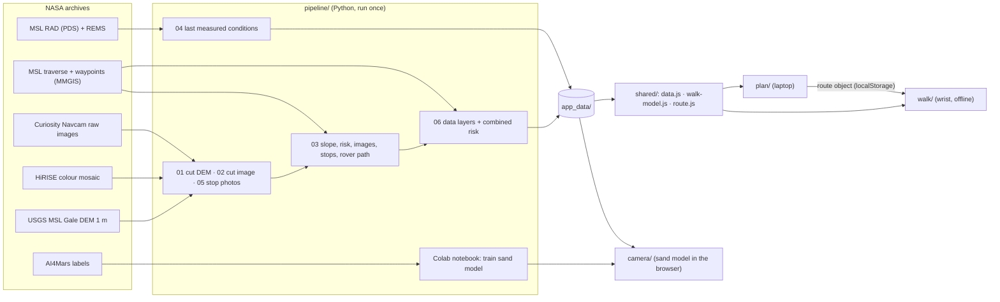

# MarsWalk · Technical documentation

How MarsWalk works, from NASA archive to wrist display: the data pipeline, the files it produces, the risk model, the
route search, the walk logic and the helmet camera model. For what the project is, see the [README](../README.md);
for every data source and how it was checked, see [`DATA_SOURCES.md`](DATA_SOURCES.md). The team's binding data
contract (Turkish, with every field) is [`CONTRACT.md`](CONTRACT.md).

## 1. Architecture



- **Static site, no server logic.** Everything runs in the browser: route search, layer combination, walk
  simulation and the sand model. `python -m http.server` is enough; GitHub Pages works too.
- **One contract between work streams.** The pipeline writes `app_data/`; the screens only read it. The planner and
  the walk screen share exactly one thing, the saved route object, and all durations come from `shared/`, so both
  screens always show the same numbers.
- **No external code at run time.** Leaflet (`shared/vendor/leaflet/`) and onnxruntime-web
  (`camera/vendor/onnxruntime-web/`) are copied into the repository; no CDN, no web fonts.

## 2. Coordinates

One system everywhere: **local metres**, `x` east and `y` north, `(0, 0)` = the south-west corner of the area.
The grid is 1,000 × 1,000 cells of 2 m; row 0 is the north edge, `index = row × cols + col`. Leaflet uses
`L.CRS.Simple` with `latlng = [y, x]`. Real Mars latitude and longitude (`xyToGeo`) are for display only. Grid size,
cell size and file names are always read from `app_data/grid.json`, never hard-coded.

## 3. Data pipeline (`pipeline/`)

| Step | Script | Input | Output |
| --- | --- | --- | --- |
| 1 | `01_cut_dem.py` | USGS DEM mosaic (3.6 GB, read remotely) | 2 × 2 km at 1 m in `data/raw/` |
| 2 | `02_cut_ortho.py` | HiRISE colour mosaic (cloud-optimised GeoTIFF) | 0.5 m image in `data/work/` |
| 3 | `05_stop_photos.py` | Navcam raw images listed in `stop_photos.json` | `app_data/photos/` |
| 4 | `03_export_app_data.py` | Steps 1–3, MSL waypoints | slope, risk, elevation, images, stops, rover path, `grid.json` |
| 5 | `06_layers.py` | Step 4, MSL traverse, HiRISE image, RAD value | `app_data/layers/`, combined `risk.bin` |
| 6 | `04_conditions.py` | MSL RAD (PDS), REMS weather report | `conditions.json` |

```bash
python pipeline/01_cut_dem.py && python pipeline/02_cut_ortho.py && python pipeline/05_stop_photos.py
python pipeline/03_export_app_data.py && python pipeline/06_layers.py && python pipeline/04_conditions.py
python tools/validate_app_data.py && node tools/make_mock_route.mjs && node tools/test_shared.mjs
```

Settings (area corners, source URLs, slope limit, layer weights and thresholds) live in `pipeline/config.py`.
Raw and intermediate files go to `data/` and are not committed. Requirements: `requirements.txt`
(numpy, scipy, rasterio, scikit-image, Pillow).

## 4. Files in `app_data/`

| File | Format | Content |
| --- | --- | --- |
| `grid.json` | JSON | Grid size, georeference, file names, risk model text, data layers, sources |
| `risk.bin` | uint8, rows × cols | Combined estimated risk 0–100 · 254 no data · 255 impassable |
| `slope.bin` | uint8 | Slope in degrees (rounded down) · 255 no data |
| `elevation.bin` | float32 little-endian | Elevation in metres · NaN no data |
| `layers/<id>.bin`, `layers/<id>.png` | uint8 + RGBA PNG | One data layer: 0–100 per cell, and its map image |
| `layers/slope_risk.bin` | uint8 | Risk from slope alone, so the browser can rebuild risk for any set of layers |
| `ortho.jpg`, `ortho_small.jpg` | JPEG | Orbital image for the planner (0.5 m) and the wrist display (1 m) |
| `risk.png`, `slope.png` | RGBA PNG | Colour map layers |
| `stops.json`, `curiosity_path.json`, `conditions.json` | JSON | Habitat and stops with photos; rover positions; last measured values |
| `photos/` | JPEG | Curiosity Navcam photo of each stop |
| `mock_route.json` | JSON | Demo route, used when no route has been planned (labelled DEMO ROUTE) |

## 5. Risk model and data layers

```latex
\text{risk} = \min\left(100,\ \max\left(0,\ \frac{\text{slope}}{20^\circ} \times 100 + \sum_i \frac{w_i \times \text{layer}_i}{100}\right)\right)
```

A cell at 20° or steeper is impassable (255) whatever the layers say: layers never open a closed cell. Slope is
taken from the 1 m DEM after 1.5 m Gaussian smoothing, and each 2 m cell keeps its steepest value.

| Layer (`id`) | Method | Weight |
| --- | --- | --- |
| `curiosity` | MSL traverse line strings rasterised at 1 m, ±3 m corridor | −20 |
| `comm` | Radial line-of-sight sweep from the habitat over the 2 m DEM; antenna 3 m, suit 2 m; Mars curvature d²/2R; a cell is visible when most rays through it clear the terrain | +20 |
| `boxwork` | Sato ridge filter on contrast-normalised HiRISE brightness; within ~40 m windows, ridge density × spread of ridge directions (mean resultant length of doubled angles); ~3 m ridge band inside boxwork zones | +15 |
| `sky` | Horizon in 24 directions out to 800 m; blocked share of the upper hemisphere; dose scaled by MSL RAD's Murray Buttes result (19 % of sky blocked → 4 % less dose) | 0, map only |

In the browser, `loadLayers(grid)` loads every layer and the slope-only risk; `combineRisk(grid, ids)` rebuilds the
risk for the layers switched on in about 10 ms. With every layer on it equals `risk.bin` byte for byte; rounding
matches JavaScript's `Math.round` on both sides, and `tools/test_shared.mjs` checks it.

**Adding a layer:** write a function in `06_layers.py` that returns a uint8 score (0–100 per cell) and its metadata
(label, effect, description, source, what it cannot see), add it to `LAYERS`, set its weight in `config.py`, rerun
step 5 and the checks. The planner lists layers from `grid.json`, so no screen code changes. Then add it to
`DATA_SOURCES.md`.

## 6. Route search (`plan/astar.js`)

A* over the grid, eight neighbours, straight-line heuristic. Step cost = distance × (1 + weight × risk / 100); cells
with no data count as risk 100; impassable cells are never entered. Two routes are computed for the chosen stops:
**Shortest** (weight 0, risk ignored) and **Lowest estimated risk** (weight 8). A multi-stop route is the legs joined
end to end. Search takes 30–110 ms on the full grid. Obstacles reported on the map mark a 16 m circle impassable and
the routes are recomputed. `buildRoute()` in `shared/route.js` turns the cells into the route object: points with
cumulative distance and time, elevation, slope, risk, stop positions and totals.

## 7. Walking model (`shared/walk-model.js`)

| Assumption | Value | Source |
| --- | --- | --- |
| Speed on level ground | 2.0 km/h | NASA Artemis walking-range study (NTRS 20210026296) |
| Speed on slopes | Tobler's hiking function × 0.4 (suit factor derived from 2.0 km/h) | Tobler 1993 |
| Longest Marswalk | 6 h | NASA EVA-EXP-0075 (6 ± 2 h) |
| Return safety margin | +20 % on the planned walk back | Our choice |
| Work at each stop | 20 min | Our choice |

`returnTimeS(route, i)` is the time to walk back to the habitat from point `i` along the same path, margin included;
`totalEvaS(route)` = walk out + work at stops + walk back. The planner warns when a plan is over 6 hours.

## 8. Plan → Walk

The planner saves the selected route with `saveRoute()` in `localStorage` (`marswalk.route.v1`) and opens `walk/`.
The walk screen reads it with `loadRoute()`; if there is none, it opens the demo route and says DEMO ROUTE.

## 9. Walk screen (`walk/`)

- **State machine** (`state.js`): `ready → walking ⇄ at_stop → returning → done`. "Done here" adds the work time and
  walks on; "Turn back" starts the return from anywhere; the position is simulated and labelled.
- **Turn back in** = 6 h − elapsed − time to walk back from here. Status strip: GO (more than 30 min left),
  TURN BACK SOON (0–30 min), TURN BACK NOW; returning and done have their own colours. Colour and word change together.
- **Path home:** when the walk heads home (Turn back, or after the last stop), the planner's A* plans a direct path
  from the current cell to the habitat on the same risk map, with the route's own risk weight. It is used only if it
  saves at least 1 min of planned time (drawn in blue, with the time saved); otherwise the astronaut walks back the
  same path. Example: stops visited 2 → 1 → 3, Turn back at 1: 63 min back the same way, 7.5 min direct. *Turn back
  in* still counts the same-path time, an upper bound, so it never promises less time than the walk home needs.
- **Measured pace:** after two minutes of planned walking, real walking time is compared with the plan; a slower
  walker gets a longer return estimate and an earlier turn-back time.
- **Oxygen (estimated):** no sensor; the 6 h suit budget shown as a percentage, with a mark for what the walk back
  from here needs. **Next stop check:** at a stop, whether there is time for the next stop and the way back.
- **Offline:** a service worker (`sw.js`) keeps the screen, the shared modules, the small map, the stops and their
  photos after the first visit (it runs on `localhost` or `https`).
- **Demo controls:** speed ×1 / ×30 / ×120 and pace 100 / 60 / 30 %, labelled as demo controls, outside the three
  main buttons.

## 10. Helmet camera (`camera/`, experimental)

| | |
| --- | --- |
| Model | DeepLabv3 + MobileNetV3-Large (torchvision, COCO-pretrained), fine-tuned on 4,700 AI4Mars Curiosity Navcam images, 512 × 512, 10 epochs, class-weighted loss |
| Training | `pipeline/colab_ai4mars_terrain.ipynb` (Google Colab, T4 GPU, about 30 minutes) |
| File | `camera/model/sand_ai4mars.onnx`, opset 17, float16 weights cast to float32 at load (22 MB; same results as float32) |
| Runtime | onnxruntime-web 1.31.1, WebAssembly, one thread; about 0.5 s per photo on a laptop |
| Input / output | Greyscale 512 × 512, 0..1 → class per pixel (0 soil, 1 bedrock, 2 sand, 3 big rock) and sand probability |
| Test (AI4Mars expert set, 322 images, `test_min1`) | Sand recall 90.5 %, precision 94.7 %, IoU 0.86 |

The page shows sand only. Big rock is weak (IoU 0.10) because the training labels hold too few rocks; a stricter
confidence threshold did not fix it. Sky and ground beyond ~30 m were never labelled, so by default only the lower
half of a photo is painted and counted. Rover hardware was masked out of the training labels, so the model can
mistake the rover's arm or deck for sand. Model card: [`camera/model/README.md`](../camera/model/README.md).

## 11. Testing and validation

- `node tools/test_shared.mjs`: coordinate round trips, walking model, a real route search on the real grid
  (shortest is never longer, low-risk is never riskier, nothing impassable), route totals, and that `combineRisk`
  with every layer on equals `risk.bin`.
- `python tools/validate_app_data.py`: every file in `grid.json` exists, raster sizes match the grid, images keep the
  grid's aspect ratio, stops lie on passable cells, `sources` are filled.
- `pipeline/preview_layers.py`: a check image of one layer with the demo route before and after it.
- Independent checks of the data are listed in [`DATA_SOURCES.md`](DATA_SOURCES.md), section 3.

## 12. Wording rules

Interface text is English. "Lowest estimated risk", never "safe"; "last measured" with its date, never "live";
the habitat and the walker's position are "hypothetical" or "simulated"; the 20 % on the way back is a "safety
margin"; assumptions are labelled "assumption"; demo data says DEMO TERRAIN or DEMO ROUTE.
