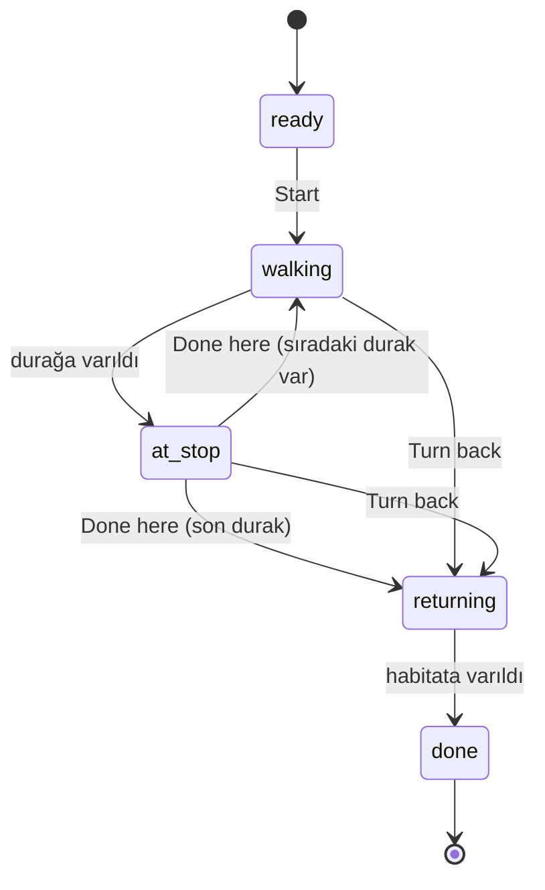

# İş kolu C · Yürüyüş ekranı ve sunum

**Branch:** `feature/walk` · **Sahibi olduğun yollar:** `walk/**`; pazar 12:00'den sonra `README.md`

Önce `docs/CONTRACT.md` dosyasını oku. Bu dosya senin iş sıranı verir; biçimlerin tanımı sözleşmededir.

## Görevin

Astronotun yürürken telefonda baktığı ekranı yapmak: sıradaki durak, kalan mesafe, en geç dönüş anı ve
yürüyüşü canlandıran bir düğme. Ekran `walk/index.html` adresinde açılır. Pazar öğleden sonra demo ve proje sayfası da sende.

`walk/` içinde çalışan bir başlangıç sayfası var: rotayı yüklüyor ve üç sayı gösteriyor. Oradan devam et.

## Dokunma

`plan/`, `shared/`, `app_data/`, `pipeline/`, `tools/`, `index.html`, `docs/`. `shared/` içinde bir eksik görürsen
kendi klasöründe çözmeye çalışma; gruba yaz (sözleşme, bölüm 1).

## Kurulum

```bash
git checkout main && git pull origin main
git checkout -b feature/walk
python -m http.server 8000        # repo kökünde; sonra http://localhost:8000/walk/
```

Telefonda denemek için: bilgisayar ve telefon aynı Wi-Fi'da olsun, telefonda `http://<bilgisayarın-IP-adresi>:8000/walk/` aç.
Tarayıcının geliştirici araçlarındaki telefon görünümü (390 × 844) de günlük çalışma için yeterli.

## Değişmez kurallar

- Planlama ekranını bekleme: kayıtlı rota yoksa `loadMockRoute()` deneme rotasını verir. B'nin işi bitince `loadRoute()` gerçek rotayı döndürür; senin kodun değişmez.
- Süre ve dönüş hesabını kendin yazma: `returnTimeS`, `totalEvaS`, `ASSUMPTIONS`, `formatDuration` kullan. Planlama ekranıyla aynı sayıyı göstermek zorundasın.
- Rota uzunluğu, durak sayısı, alan boyutu koda sabit yazılmaz; hepsi rota nesnesinden okunur.
- Eldivenli kullanım: ekranda en fazla **üç büyük düğme**, hiçbir yerde yazı girişi yok, dokunma hedefleri en az 64 px.
- Dışarıdan (CDN) hiçbir şey yükleme. Arayüz metinleri İngilizce.
- Astronotun konumu gerçek değil, canlandırma. Ekranda "SIMULATED POSITION" etiketi görünür.

## Ekranın düzeni

Telefon ekranı (390 × 844), yukarıdan aşağıya. Kaydırma yok; her şey tek ekrana sığar.

```
┌──────────────────────────────────┐
│ MarsWalk · Walk   [SIMULATED POSITION] │  başlık + etiket
├──────────────────────────────────┤
│                                  │
│   harita: rota, duraklar, konum  │  ekranın ~%35'i
│                      demo ×30    │  hız seçimi, küçük, köşede
├──────────────────────────────────┤
│              GO                  │  durum şeridi: yeşil / sarı / kırmızı
├──────────────────────────────────┤
│ Next stop                        │
│ Ridge junction · 240 m           │  en büyük yazı
├────────────────┬─────────────────┤
│ Elapsed        │ Turn back in    │
│ 1 h 10 min     │ 4 h 15 min      │
├────────────────┴─────────────────┤
│ [ Start / Pause ]                │
│ [ Done here ]                    │  üç büyük düğme, her biri ≥ 64 px
│ [ Turn back ]                    │
└──────────────────────────────────┘
```

Durakta iken harita yerine (ya da üzerinde) durak kartı açılır: ad, açıklama, varsa fotoğraf.

## Yürüyüşün akışı



- "Pause" bir durum değil; hangi durumda olursa olsun zamanı durdurur.
- `returning` iken "Turn back" ve "Done here" düğmeleri devre dışı görünmez, tamamen gizlenir; yerlerine dönüş bilgisi gelir.

## "Turn back in" hesabı

```
turnBackInS = ASSUMPTIONS.EVA_LIMIT_S − elapsedS − returnTimeS(route, pointIndex)
```

Örnek: sınır 6 saat, geçen süre 1 saat 10 dakika, buradan dönüş 35 dakika → **4 saat 15 dakika**.
Astronot uzaklaştıkça dönüş süresi uzadığı için bu sayı iki yönden azalır. `elapsedS` duraklardaki çalışma sürelerini de içerir.

| Kalan süre | Durum şeridi | Renk |
| --- | --- | --- |
| 30 dakikadan fazla | `GO` | yeşil |
| 0 – 30 dakika | `TURN BACK SOON` | sarı |
| 0'ın altında | `TURN BACK NOW` | kırmızı |

`returning` durumunda şerit `RETURNING` yazar ve "Turn back in" yerine "Habitat in" (habitata kalan süre) gösterilir.

## Takvim

| Ne zaman | İş | Yaklaşık süre |
| --- | --- | --- |
| Cumartesi akşam | Adım 1: yürüyüş durumu | 2–3 saat |
| Cumartesi akşam | Adım 2–4: göstergeler, düğmeler, canlandırma hızı | 2–3 saat |
| **Cumartesi gece hedefi** | Deneme rotasında yürüyüş baştan sona çalışıyor, sayfa telefonda açılıyor; ilk PR | |
| Pazar sabah | Adım 5–7: harita, durak kartı, telefon kontrolü | 2–3 saat |
| **Pazar 10:00** | Çekirdek donar; B'nin ekranından gelen rotayla prova | |
| Pazar 10:00 – 12:00 | Çekirdekten sonraki işler (internetsiz çalışma) | 2 saat |
| Pazar 12:00 – 15:30 | Demo, proje sayfası, README, teslim | 3,5 saat |

## İş sırası

Her adımın sonunda sayfa çalışır durumda olsun ve bir commit at.

### 1. Yürüyüş durumu (`walk/state.js`)

Ekrandan bağımsız, saf bir durum modülü yaz; arayüz yalnızca bunu okur. Sonradan eklenecek özellikler (konum doğrulama gibi) buraya bağlanacak.

- Durum: `phase` (`ready` | `walking` | `at_stop` | `returning` | `done`), `pointIndex` (rota üzerindeki konum), `elapsedS`, `nextStop`.
- `tick(dtS)`: canlandırma süresini ilerletir. `walking` iken konum, `route.points[].time` değerlerine göre ilerler. `returning` iken aynı yol tersine, `RETURN_FACTOR` ile yürünür.
- Durağa varınca `at_stop` olur ve bekler; astronot "Done here" deyince `STOP_WORK_S` süresi eklenir ve sıradaki durağa yürünür.
- Son duraktan sonra, ya da astronot "Turn back" deyince `returning` başlar; habitata varınca `done`.

### 2. Ana göstergeler

Büyük yazıyla, tek bakışta:

- **Next stop:** adı ve oraya kalan mesafe (m). Dönüşte "Habitat".
- **Elapsed:** geçen süre.
- **Turn back in:** dönmeye başlamak için kalan süre = `EVA_LIMIT_S − elapsedS − returnTimeS(route, pointIndex)`.
- **Durum rengi:** kalan süre 30 dakikadan fazlaysa yeşil ("GO"), 0–30 dakika sarı ("TURN BACK SOON"), eksiye düştüyse kırmızı ("TURN BACK NOW"). Eşikler `walk/` içinde sabit olarak dursun.

### 3. Düğmeler (en fazla üç)

- **Start / Pause**
- Duruma göre değişen ana düğme: durakta "Done here"
- **Turn back**

### 4. Canlandırma hızı

Demo için hız seçimi (×1, ×30, ×120). Küçük, köşede; üç ana düğmeden sayılmaz ve "demo control" olarak etiketlenir.

### 5. Küçük harita

Ekranın üst yarısında Leaflet haritası (`L.CRS.Simple`): `fileUrl(grid, 'ortho_small')` görseli, rota çizgisi, duraklar, habitat ve astronotun konumu. Konum ilerledikçe harita onu takip eder. Kurulum için `plan/plan.js` başlangıç dosyasına bakabilirsin (kopyala, o dosyayı değiştirme).

### 6. Durak kartı

`at_stop` iken: durağın adı, açıklaması ve varsa fotoğrafı (`stops.json` içindeki `photo`; yoksa kart fotoğrafsız görünür).
Rota nesnesindeki durak `id` değeriyle `loadJson(grid, 'stops')` içinden eşleştir.

### 7. Telefon kontrolü

390 × 844 ekranda kaydırma olmadan her şey görünmeli. Gerçek bir telefonda aç ve güneş altında okunuyor mu diye bak (yüksek kontrast).

## Bitti sayılır

- [ ] Deneme rotasıyla: Start → duraklar → dönüş → habitat akışı baştan sona yürüyor
- [ ] Kalan mesafe durağa varınca 0 oluyor; "Turn back in" süresi yürüdükçe azalıyor
- [ ] Hız ×120 iken de duraklar atlanmıyor
- [ ] "Turn back" her aşamada çalışıyor ve habitata götürüyor
- [ ] Planlama ekranından "Start walk" ile gelindiğinde seçilen rota yükleniyor, "DEMO ROUTE" etiketi kayboluyor
- [ ] Ekranda en fazla üç ana düğme var, yazı girişi yok
- [ ] Tarayıcı konsolunda hata yok; PR yalnızca `walk/` yollarını içeriyor

## Pazar 12:00'den sonra: demo ve proje sayfası

Bu saatte koddan çık. Yarım kalan ekran işi varsa gruba söyle; demo, yarım bir özellikten daha değerli.

**Bugünden (cumartesi) yap:** Güncel Project Submission Guide'dan demo sınırını teyit et ve gruba yaz. Okuduğumuz 2025 sürümünde sınır en fazla 30 saniyelik video (İngilizce altyazılı) ve en fazla 7 slayttı; sınırı aşan proje küresel jüriden eleniyor.

### Demo videosu

Ekran kaydı, 1280 × 720. Çekim sırası:

1. Planlama ekranı: iki durak seçilir, iki rota belirir.
2. İki rota kartı yan yana: mesafe, süre, risk farkı.
3. "Start walk": telefon ekranı (telefon kaydı ya da tarayıcının telefon görünümü).
4. Canlandırma hızlı oynatılır: konum ilerler, durak kartı açılır.
5. Durum şeridi sarıya döner, "Turn back" ile dönüş başlar.

Sesli anlatım yerine ekranda kısa İngilizce altyazılar kullan. Her çekimi ayrı kaydet, sonra birleştir; tek seferde çekmeye çalışma.

### Proje sayfası (hepsi İngilizce)

| Alan | Kaynak |
| --- | --- |
| High-level summary | 2–3 cümle: ne, kimin için, neden farklı |
| Detailed description | Ne yapar, nasıl çalışır, hangi araçlarla yapıldı, varsayımlar ve sınırlar |
| NASA data | `app_data/grid.json` içindeki `sources` listesi (A iş kolu dolduruyor) + `conditions.json` kaynakları |
| Other data and tools | Leaflet, Python kütüphaneleri, USGS mozaikleri |
| Use of AI | Claude (kod ve belge yazımında yardım), Argon (ilk arayüz taslağı) |
| Demo link, project link | Herkese açık video/slayt linki ve canlı site ya da repo linki |

Ana cümle: "Existing tools start from the map and adapt it to the astronaut. We started from the astronaut's constraints: gloves, fatigue, no GPS, and no real-time link to Earth."

### README ve teslim

- `README.md`: proje nedir, nasıl çalıştırılır, veri kaynakları, varsayımlar ve sınırlar (İngilizce).
- Bütün linkleri gizli sekmede, giriş yapmadan aç.
- **"Submit for Judging": pazar 15:30** (son saat 17:00). Bu düğme geri alınamaz; basmadan önce üç kişi de sayfayı okusun.

### Senin için gerekenler

- Deneme için bir telefon, bilgisayarla aynı Wi-Fi'da
- Ekran kaydı aracı (Windows: Xbox Game Bar ya da OBS; telefon: yerleşik ekran kaydı)
- Videoyu yükleyeceğin herkese açık bir yer (YouTube "liste dışı" ya da Drive "bağlantıya sahip herkes")

## Çekirdekten sonra (pazar 10:00 – 12:00, sırayla)

1. İnternetsiz çalışma: `walk/` için service worker ve manifest (telefonda uçak modunda açılmalı).
2. Gerçek hıza göre güncellenen dönüş anı: astronot plandan yavaşsa "Turn back in" buna göre kısalır.
